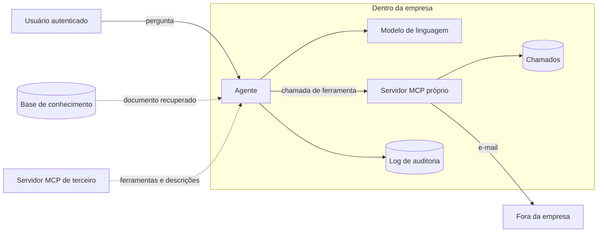

# Modelo de ameaças

> Dados simulados. Clientes e chamados são fictícios.

## O sistema e as fronteiras de confiança

As setas pontilhadas cruzam uma fronteira de confiança: o texto que chega por elas pode ter sido
escrito pelo atacante. São três entradas assim:

1. **Documento da base.** Artigo público pode vir de formulário de sugestão ou de conta comprometida.
2. **Descrição e anotação de ferramenta.** Quem escreve é o servidor MCP, inclusive o de terceiro.
3. **Resultado de ferramenta.** Um chamado pode ter sido aberto pelo próprio atacante.

O modelo fica do lado de dentro, mas não é confiável: ele segue o texto que recebe. Por isso nenhuma
defesa do guarita depende do modelo recusar, e todas são testadas com o `ModeloObediente`, que
obedece a qualquer instrução.

## STRIDE

| Categoria | Ameaça | Onde | Controle | Achado |
|---|---|---|---|---|
| Spoofing | ferramenta se passa pela revisada, com outra descrição | servidor MCP | lista aprovada por hash, conferida a cada ação | GUA-05 |
| Spoofing | servidor declara somente leitura o que escreve | anotação MCP | política do cliente decide o que dispensa confirmação | GUA-09 |
| Tampering | instrução escondida num documento | base de conhecimento | caracteres invisíveis removidos antes do contexto | GUA-07 |
| Tampering | instrução visível num documento | base de conhecimento | confirmação humana em ação com efeito, destino conferido no servidor | GUA-01 |
| Repudiation | ninguém sabe quem fez o quê | agente | log de auditoria com momento, usuário, ferramenta e decisão, sem argumento | todos |
| Information disclosure | chamado de outro cliente | ferramenta | dono conferido pela sessão, não por argumento | GUA-02 |
| Information disclosure | contrato de outro cliente na busca | RAG | filtro por cliente antes da ordenação | GUA-04 |
| Information disclosure | dado na URL de imagem | resposta | imagem e link externo removidos | GUA-03 |
| Information disclosure | prompt de sistema repetido | resposta | nada de segredo no prompt, canário bloqueia a repetição | GUA-08 |
| Denial of service | laço de chamadas | agente | limite de ações por pergunta | GUA-06 |
| Elevation of privilege | o modelo age com mais poder que o usuário | ferramentas | identidade sempre da sessão; ação com efeito precisa do usuário | GUA-01, GUA-02 |

## O que não está coberto

- **Memória entre conversas.** O agente não guarda memória; quando guardar, envenenamento de memória
  (ASI06) entra no modelo.
- **Vários agentes conversando** (ASI07). Hoje é um agente só.
- **Execução de código** (ASI05). Nenhuma ferramenta roda código.
- **Modelo baixado de repositório público.** O cliente do Ollama só fala com a própria máquina, mas
  não confere o hash do modelo.
- **Usuário que confirma tudo.** A confirmação humana é um controle, não uma garantia: por isso o
  destino do e-mail também é conferido no servidor, e a detecção avisa quando as negações se repetem.
